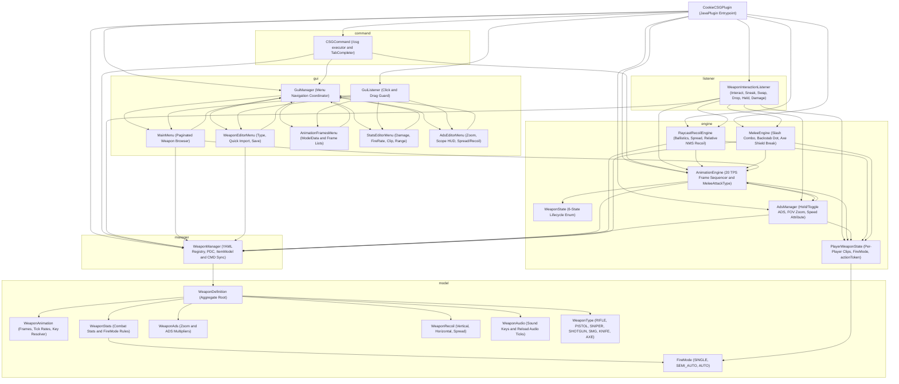
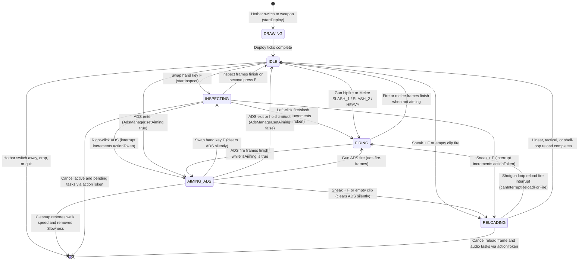
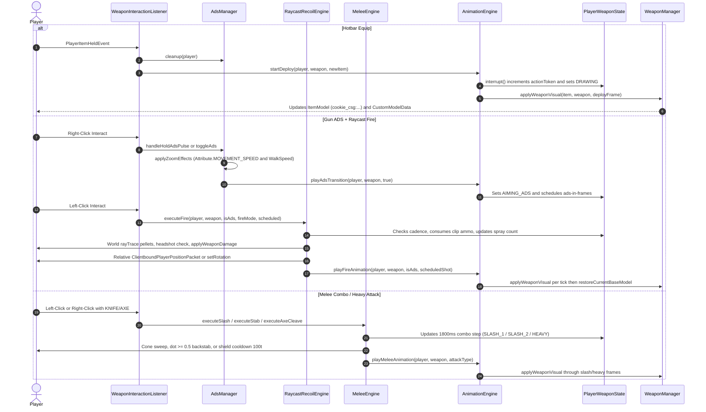

# CookieCSG — CodeGraph & Architecture Reference

> **Snapshot Date:** `2026-11-26`  
> **Platform:** Paper API `1.21.4-R0.1-SNAPSHOT` | **Language:** Java `21` | **Test Framework:** JUnit Jupiter `5.11.4`  
> **Scope:** Original Paper tactical weapon, animation, recoil, ADS, melee combat, and in-game GUI editor codebase (`com.cookie.csg`).

---

## 1. Overview & Package Metrics

All metrics below are verified directly against the Java sources under `src/main/java/com/cookie/csg/` and `src/test/java/com/cookie/csg/`.

| Package | Classes / Files | Lines | Public Constructors | Public Methods | Key Responsibilities |
| :--- | :---: | :---: | :---: | :---: | :--- |
| `com.cookie.csg` | 1 | 154 | 0 | 18 | Plugin bootstrap, config lifecycle, manager/engine wiring, re-entrant damage guard |
| `com.cookie.csg.command` | 1 | 174 | 1 | 2 | `/csg` command routing (`gui`, `editor`, `edit`, `give`, `list`, `reload`) & tab completion |
| `com.cookie.csg.listener` | 1 | 510 | 1 | 12 | Input handling, auto-fire scheduling, double-sneak fire-mode cycling, inventory/join/quit sync |
| `com.cookie.csg.manager` | 1 | 832 | 3 | 16 | YAML weapon loading/saving, alias resolution, Paper `ItemModel` + `CustomModelData` visual dispatch |
| `com.cookie.csg.engine` | 6 | 2,155 | 5 | 102 | Frame animation engine, ADS zoom/FOV compensation, raycast ballistics & NMS recoil, melee combos |
| `com.cookie.csg.gui` | 7 | 1,329 | 7 | 25 | Paginated chest-UI weapon manager, quick-import hopper, animation/stats/ADS editors |
| `com.cookie.csg.model` | 8 | 1,144 | 12 | 161 | Weapon data models (`WeaponDefinition`, `WeaponAnimation`, `WeaponStats`, `WeaponAds`, `WeaponRecoil`, `WeaponAudio`, enums) |
| **Total Main Source** | **25** | **6,298** | **29** | **336** | **365 total public callables** (+ `1` nested public enum, `4` public constants) |
| `src/test/java` (`com.cookie.csg.*`) | **5** | **4,105** | — | **68 `@Test`** | Unit tests, YAML round-trip tests, and 20 TPS Paper proxy combat/animation simulator |

---

## 2. Architecture & Package Dependency Graph

---

## 3. Weapon State Machine & Action-Token Cancellation

`WeaponState` defines 6 runtime states (`IDLE`, `DRAWING`, `AIMING_ADS`, `FIRING`, `INSPECTING`, `RELOADING`). Melee combos (`AnimationEngine.MeleeAttackType`: `SLASH_1`, `SLASH_2`, `HEAVY`) run inside `FIRING`.

Every cancellable transition calls `PlayerWeaponState.interrupt()`, which atomically increments `actionToken`, cancels `activeTask` and all queued `pendingTasks`, resets `currentFrameIndex = 0`, and resolves back to `AIMING_ADS` when `isAiming` is true or `IDLE` otherwise. Any Bukkit scheduler tick observing `state.getActionToken() != token` or a mismatched `WeaponState` exits immediately without mutating visuals or ammo.

---

## 4. Runtime Combat & Animation Pipeline

---

## 5. Complete Class & Responsibility Index

### 5.1 Core Plugin (`com.cookie.csg`)

| Class | Lines | Ctors / Methods | Key Symbols & Verified Responsibilities |
| :--- | :---: | :---: | :--- |
| `CookieCSGPlugin` | 154 | `0 / 18` | `onEnable`, `onDisable`, `reloadPluginConfig`, `applyWeaponDamage`, `isApplyingWeaponDamage`. Loads `gun-controls` (`right-click-fire`, `hold-to-ads`, `hold-ads-release-ms` min `100L`), initializes `WeaponManager`, `AdsManager`, `RaycastRecoilEngine`, `MeleeEngine`, `AnimationEngine`, and `GuiManager`, registers `WeaponInteractionListener`, `GuiListener`, and `/csg`, and prevents recursive `EntityDamageByEntityEvent` cancellation via `APPLYING_WEAPON_DAMAGE`. |

### 5.2 Command & Listener (`com.cookie.csg.command`, `com.cookie.csg.listener`)

| Class | Lines | Ctors / Methods | Key Symbols & Verified Responsibilities |
| :--- | :---: | :---: | :--- |
| `CSGCommand` | 174 | `1 / 2` | `onCommand`, `onTabComplete`. Implements `/csg` subcommands (`editor`/`gui`, `edit <id>`, `give <player> <id>`, `list`, `reload`), syncs held weapon state on `/csg give`, and provides player/weapon/alias tab completions. |
| `WeaponInteractionListener` | 510 | `1 / 12` | `DOUBLE_SHIFT_WINDOW_MS = 400L`, `onPlayerInteract`, `onInteractEntity`, `onToggleSneak`, `onSwapHand`, `onDropItem`, `onItemHeldChange`, `onPlayerJoin`, `onPlayerQuit`, `onEntityPickupItem`, `onInventoryClick`, `onPlayerRespawn`, `onEntityDamage`. Deduplicates `45ms` interact/damage overlap, drives continuous `AUTO` fire tasks, cycles fire modes on double-sneak, maps `F` to inspect and `Shift+F` to gun reload, and syncs swing-suppression on slot/inventory changes. |

### 5.3 Registry & Persistence (`com.cookie.csg.manager`)

| Class | Lines | Ctors / Methods | Key Symbols & Verified Responsibilities |
| :--- | :---: | :---: | :--- |
| `WeaponManager` | 832 | `3 / 16` | `loadWeapons`, `saveWeapon`, `createDefaultWeapons`, `buildItemStack`, `resolveItemModel`, `applyWeaponVisual`, `resolveSoundKey`, `isWeapon`, `getWeaponId`, `getWeapon`, `createWeapon`, `deleteWeapon`. Reads/writes `plugins/CookieCSG/weapons/*.yml`, ignores YAML files lacking `id`, indexes `(Material, CMD)` in `cmdLookup`, resolves legacy aliases via `ID_ALIASES`, assigns `cookiecsg:weapon_id` PDC and `ATTACK_SPEED`/`BLOCK_BREAK_SPEED` modifiers, and resolves Paper 1.21.4 `cookie_csg:*` `ItemModel` keys. |

### 5.4 Simulation & Combat Engines (`com.cookie.csg.engine`)

| Class | Lines | Ctors / Methods | Key Symbols & Verified Responsibilities |
| :--- | :---: | :---: | :--- |
| `AnimationEngine` | 801 | `1 / 22` | `SWING_SUPPRESS_HASTE_AMPLIFIER = 6`, `MeleeAttackType` (`SLASH_1`, `SLASH_2`, `HEAVY`), `startDeploy`, `startInspect`, `playAdsTransition`, `playFireAnimation`, `playReloadAnimation`, `canInterruptReloadForFire`, `playMeleeAnimation`, `applySwingSuppression`, `clearSwingSuppression`, `syncHeldWeaponState`, `restoreCurrentBaseModel`, `resetIdleModel`. Drives 20 TPS deploy, inspect, ADS transition, hipfire/ADS fire, linear/tactical reload, and intro/loop/end shotgun shell reload with scheduled clip-in/bolt sounds. |
| `PlayerWeaponState` | 428 | `1 / 61` | `interrupt`, `nextActionToken`, `getActionToken`, `getAmmoInClip`, `setAmmoInClip`, `getFireMode`, `cycleFireMode`, `cancelAutoFire`, `cancelAdsHold`, `resetSprayState`. Stores per-weapon clip ammo (`ammoByWeapon`) and `fireModeByWeapon`, active/pending `BukkitTask` handles, melee combo tracking, spray counters, and saved Haste state. |
| `AdsManager` | 385 | `1 / 14` | `toggleAds`, `handleHoldAdsPulse`, `setAiming`, `clearAimingSilently`, `targetFovModifierForZoomLevel`, `computeZoomWalkSpeed`, `applyZoomEffects`, `removeZoomEffects`, `sanitizeStaleZoomState`, `cleanup`, `cleanupAll`. Balances zoom FOV reduction across levels `1..5+` via `walkSpeed` + `Attribute.MOVEMENT_SPEED` scalar modifier (`cookiecsg:ads_move_speed`) with `SLOWNESS` fallback and hold-ADS watchdog tasks. |
| `RaycastRecoilEngine` | 341 | `1 / 2` | `RECOIL_TELEPORT_ID = Integer.MAX_VALUE`, `executeFire`, `clampDeltaPitch`. Enforces `SINGLE` / `SEMI_AUTO` / `AUTO` cadence, consumes ammo, triggers dryfire auto-reload at `0`, computes mode/ADS/sprint/air spread and `8`-pellet shotgun traces, applies `>= 1.45` (or `0.78 * height`) headshot multipliers, and dispatches relative `ClientboundPlayerPositionPacket` recoil via reflection with `player.setRotation` fallback. |
| `MeleeEngine` | 190 | `1 / 3` | `MIN_MELEE_COOLDOWN_MS = 150L`, `MELEE_COMBO_WINDOW_MS = 1800L`, `executeSlash`, `executeStab`, `executeAxeCleave`. Executes `3.0`-block directional cone slashes alternating `SLASH_1`/`SLASH_2`, `2.8`-block knife stabs (`dot >= 0.5` backstab multiplier, else `1.2x`), and `3.2`-block axe cleaves disabling blocking shields (`100` ticks), inflicting `SLOWNESS`, and applying knockback. |
| `WeaponState` | 10 | `0 / 0` | Enum with 6 lifecycle states: `IDLE`, `DRAWING`, `AIMING_ADS`, `FIRING`, `INSPECTING`, `RELOADING`. |

### 5.5 In-Game GUI Editors (`com.cookie.csg.gui`)

| Class | Lines | Ctors / Methods | Key Symbols & Verified Responsibilities |
| :--- | :---: | :---: | :--- |
| `GuiManager` | 47 | `1 / 7` | `openMainMenu`, `openWeaponEditor`, `openAnimationFramesMenu`, `openFramesEditor`, `openStatsEditor`, `openAdsEditor`. Creates and opens `InventoryHolder` editor menus. |
| `GuiListener` | 108 | `1 / 2` | `onInventoryClick`, `onInventoryDrag`. Cancels unauthorized GUI clicks/shift-clicks/drags across all 5 menus while allowing slot `8` quick-import drags in `WeaponEditorMenu`. |
| `MainMenu` | 188 | `1 / 2` | `handleClick`, `getInventory`. 54-slot paginated browser (`45` weapons/page), page navigation, new weapon creation (`slot 49`), left-click test item grant, right-click editor launch. |
| `WeaponEditorMenu` | 261 | `1 / 5` | `render`, `handleQuickImport`, `handleQuickImportDrag`, `handleClick`, `getInventory`. Live item preview (`slot 4`), Material/CMD quick-import hopper (`slot 8`), type cycler (`slot 19`), sub-editor links (`slots 21, 23, 25`), YAML save (`slot 45`), test item (`slot 53`). |
| `AnimationFramesMenu` | 335 | `1 / 3` | `render`, `handleClick`, `getInventory`. Interactive editor for `idleModelData`, `deployModelData`, `deployTicks`, `adsModelData`, `adsFireModelData`, `fireFrames`, `inspectFrames`, `inspectTickRate`, and `reloadFrames` with cursor-item CMD capture. |
| `StatsEditorMenu` | 213 | `1 / 3` | `render`, `handleClick`, `getInventory`. Adjusts `damage`, `headshotMultiplier`, `fireRateTicks`, `clipSize`, `maxAmmo`, `reloadTicks`, and `range`. |
| `AdsEditorMenu` | 177 | `1 / 3` | `render`, `handleClick`, `getInventory`. Toggles ADS `enabled` and `scopeOverlay`, and tunes `zoomLevel` (`1..10`), `spreadMultiplier`, and `recoilMultiplier`. |

### 5.6 Data Models (`com.cookie.csg.model`)

| Class | Lines | Ctors / Methods | Key Symbols & Verified Responsibilities |
| :--- | :---: | :---: | :--- |
| `WeaponAnimation` | 471 | `2 / 58` | Holds base CMDs, frame lists (`deployFrames`, `adsInFrames`, `adsFireFrames`, `adsOutFrames`, `fireFrames`, `slash2Frames`, `heavyFrames`, `inspectFrames`, `reloadFrames`, `reloadTacticalFrames`, `reloadIntroFrames`, `reloadLoopFrames`, `reloadEndFrames`), per-action tick rates, `frameModels` overrides, `resolveSlash2Frames`, `resolveHeavyFrames`, and cached `resolveModelKey`. |
| `WeaponStats` | 221 | `2 / 34` | Stores combat stats, `reloadTacticalTicks`, `fireModes`, `defaultFireMode`, `burstCount`, `resolveSupportedFireModes` (capped at 2 modes per gun), and `resolveDefaultFireMode`. |
| `WeaponAudio` | 154 | `2 / 26` | Stores sound keys (`shoot`, `adsIn`, `adsOut`, `deploy`, `reloadClipOut`, `reloadClipIn`, `reloadBolt`, `inspect`, `empty`, `backstab`, `shieldBreak`) and custom `reloadClipInTick` / `reloadBoltTick` offsets. |
| `WeaponDefinition` | 116 | `2 / 20` | Root weapon aggregate combining `id`, `displayName`, `type`, `material`, `WeaponAnimation`, `WeaponStats`, `WeaponAds`, `WeaponRecoil`, and `WeaponAudio`. |
| `WeaponAds` | 66 | `2 / 10` | Stores `enabled`, `zoomLevel`, `spreadMultiplier`, `recoilMultiplier`, and `scopeOverlay`. |
| `WeaponRecoil` | 55 | `2 / 8` | Stores `vertical`, `horizontal`, `spread`, and `sprintSpreadMultiplier`. |
| `FireMode` | 32 | `0 / 2` | Enum (`SINGLE`, `SEMI_AUTO`, `AUTO`) with `getDisplayName` and normalizing `fromString`. |
| `WeaponType` | 29 | `0 / 3` | Enum (`RIFLE`, `PISTOL`, `SNIPER`, `SHOTGUN`, `SMG`, `KNIFE`, `AXE`) with `isMelee`, `isGun`, and `getDefaultDamage`. |

### 5.7 JUnit 5 Test Suites (`src/test/java/com/cookie/csg/`)

| Test Suite | Lines | `@Test` Count | Verified Coverage |
| :--- | :---: | :---: | :--- |
| `AnimationSimulatorTest` | 3,294 | 42 | Paper `Server` / `RegistryAccess` proxy harness + deterministic 20 TPS `FakeScheduler` verifying deploy, inspect, second-`F` cancel, zero-flash interrupt, hold/toggle ADS, linear vs tactical vs shell-loop reload, fire-mode cycling, relative recoil, melee combos, swing suppression, GUI clicks, and sound namespaces. |
| `WeaponManagerTest` | 487 | 9 | Default weapon generation, YAML save/load round-trips (shotgun loop reload, `slash2`/`heavy` frames, fire modes), neutralized YAML ignore, alias resolution, and deployment-pack CMD/JSON integrity. |
| `EngineCombatTest` | 153 | 8 | `WeaponState` enum coverage, `PlayerWeaponState` interrupt lifecycle, backstab dot-product geometry, headshot threshold math, spread multipliers, monotonic ADS zoom FOV reduction, pitch clamping, and multi-pack fire-mode invariants. |
| `WeaponModelTest` | 127 | 6 | Unit assertions for `WeaponAnimation`, `WeaponStats`, `WeaponAds`, `WeaponRecoil`, `WeaponAudio`, and `WeaponDefinition`. |
| `WeaponTypeTest` | 44 | 3 | Melee vs gun classification and default damage values across all 7 `WeaponType` constants. |
