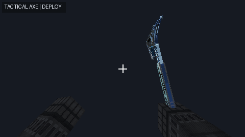
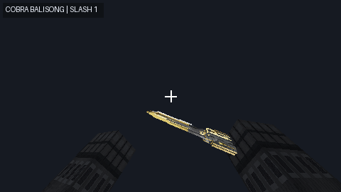
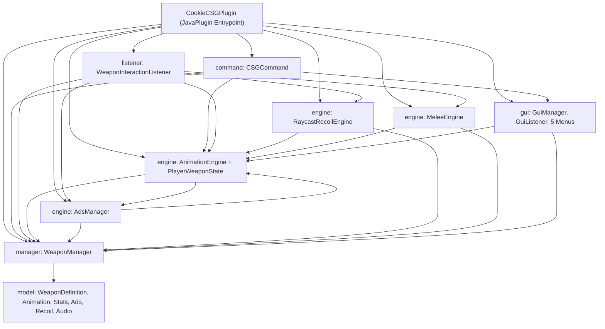
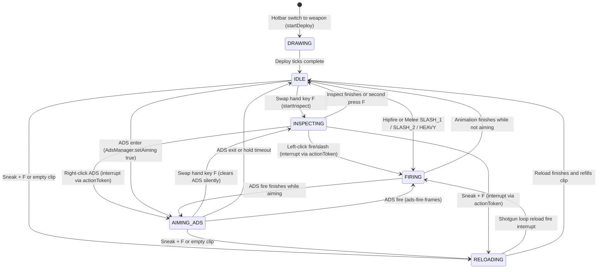

# CookieCSG

[](https://adoptium.net/)
[](https://papermc.io/)
[](pom.xml)
[](src/test/java/com/cookie/csg/)

**CookieCSG** is an original Paper `1.21.4+` Java tactical weapon and 20 TPS frame-animation engine plugin featuring raycast recoil ballistics, optical ADS zoom with movement-speed compensation, multi-stage melee combos, and an in-game chest GUI weapon editor.

---

## Key Features

- **20 TPS Frame-Based Animation Engine (`AnimationEngine`):** Plays smooth tick-synchronized `deploy`, `fire`, `ads-in` / `ads-fire` / `ads-out`, `inspect`, `reload`, `reload-tactical`, and phased shotgun `intro` / `loop` / `end` shell reloads using monotonic `actionToken` cancellation (`PlayerWeaponState`) and simultaneous Paper `1.21.4` `ItemModel` + `CustomModelData` updates.
- **Raycast Recoil & Ballistics (`RaycastRecoilEngine`):** Multi-pellet shotgun patterns, height-based headshot detection, sprint/airborne/fire-mode spread multipliers, dynamic consecutive-shot spray scaling, and relative camera recoil packets (`ClientboundPlayerPositionPacket` with `Player.setRotation` fallback).
- **Universal ADS & Optical Zoom (`AdsManager`):** Supports both hold-to-ADS watchdog timing and toggle ADS, compensates client FOV reduction across zoom levels `1–5+` via `walkSpeed` + `Attribute.MOVEMENT_SPEED` modifiers, and supports optional scope overlays.
- **Melee Combo & Heavy Mechanics (`MeleeEngine`):** Alternates `SLASH_1` and `SLASH_2` attacks inside an `1800ms` combo window, computes directional horizontal dot-product backstabs for knives, and executes shield-disabling (`100` ticks) heavy axe cleaves with knockback and slowness.
- **In-Game GUI Weapon Editor (`GuiManager`):** Paginated 54-slot weapon browser (`MainMenu`), drag-and-drop quick-import hopper (`WeaponEditorMenu`), frame list editor (`AnimationFramesMenu`), combat stats tuner (`StatsEditorMenu`), and ADS configurator (`AdsEditorMenu`) with instant YAML saving.
- **YAML Weapon Registry (`WeaponManager`):** Hot-reloadable `weapons/*.yml` registry with legacy alias lookup, `PersistentDataContainer` + `(Material, CustomModelData)` + `ItemModel` matching, and automatic `ATTACK_SPEED` / `BLOCK_BREAK_SPEED` cooldown suppression.

---

## Weapon Animation Showcase

| Weapon | Category | Highlighted Animation Clips | Preview |
| :--- | :---: | :--- | :---: |
| **Tactical Axe** | `AXE` | Deploy, Combo Slash, Heavy Cleave, Inspect |  |
| **Dark Star** | `KNIFE` | Deploy, Dual-Blade Slash, Backstab, Inspect |  |
| **Balisong** | `KNIFE` | Deploy, Quick Slash, Flip Inspect |  |
| **AK-47** | `RIFLE` | Deploy, Full-Auto Fire, Tactical Reload, Inspect |  |

---

## Architecture & CodeGraph

CookieCSG separates input handling (`listener`), command dispatch (`command`), YAML registry & item visuals (`manager`), simulation engines (`engine`), inventory editors (`gui`), and configuration data models (`model`).

> See the complete metrics, class index, and runtime sequence pipeline in [Full CodeGraph Documentation](CodeGraph.md).

### Package Dependency Architecture



### Weapon Lifecycle State Machine (`WeaponState`)



---

## Controls, Commands & Permissions

### Default In-Game Controls

- **Left-Click:** Fire gun (`right-click-fire: false`) or Melee Slash (`SLASH_1` / `SLASH_2` combo).
- **Right-Click:** Aim Down Sights (hold or toggle per `config.yml`) or Melee Heavy Attack (knife backstab / axe shield-breaking cleave).
- **Swap Hand (`F`):** Inspect held weapon (press `F` again to cancel immediately).
- **Sneak + Swap Hand (`Shift + F`):** Reload firearm (supports tactical vs. empty reloads and interruptible shotgun shell loops).
- **Double-Sneak (`Shift x2` within `400ms`):** Cycle fire mode (`AUTO` / `SEMI_AUTO` / `SINGLE`) on multi-mode firearms.

### Commands & Permissions

Defined in [plugin.yml](src/main/resources/plugin.yml) and handled by [CSGCommand.java](src/main/java/com/cookie/csg/command/CSGCommand.java):

| Command | Aliases / Usage | Description | Permission |
| :--- | :--- | :--- | :--- |
| `/csg` | `/cookiecsg`, `/gun`, `/guns` | Opens the in-game GUI weapons manager (`MainMenu`) for players, or prints help in console | `cookiecsg.use` (`default: true`) |
| `/csg editor` | `/csg gui` | Opens the in-game GUI weapons manager (`MainMenu`) | `cookiecsg.use` |
| `/csg edit <id>` | — | Opens `WeaponEditorMenu` directly for `<id>` | `cookiecsg.use` |
| `/csg give <player> <id>` | — | Gives `<id>` (including aliases) to `<player>` and syncs held weapon state | `cookiecsg.use` |
| `/csg list` | — | Lists all registered weapons, types, and display names | `cookiecsg.use` |
| `/csg reload` | — | Hot-reloads `config.yml` and all weapon YAML files | `cookiecsg.use` |

Additional declared permission node in `plugin.yml`: `cookiecsg.admin` (`default: op`, reserved for administrative setups).

---

## Configuration

### Global Plugin Config (`src/main/resources/config.yml`)

```yaml
gun-controls:
  right-click-fire: false
  hold-to-ads: true
  hold-ads-release-ms: 350
```

- `gun-controls.right-click-fire`: When `false`, Left-Click fires and Right-Click controls ADS; when `true`, swaps to Right-Click fire and Left-Click ADS.
- `gun-controls.hold-to-ads`: Enables hold-to-ADS behavior when `right-click-fire` is `false`.
- `gun-controls.hold-ads-release-ms`: Release watchdog timeout in milliseconds (minimum clamped to `100ms` in `CookieCSGPlugin`).

### Weapon YAML Schema (`plugins/CookieCSG/weapons/<id>.yml`)

```yaml
id: tactical_rifle
display-name: '&6&lTactical Rifle'
type: RIFLE
material: IRON_HOE
animation:
  idle-model: 100100
  deploy-model: 300001
  deploy-ticks: 17
  deploy-tick-rate: 1
  deploy-frames: [300001, 300002]
  ads-model: 300036
  ads-fire-model: 300037
  ads-in-frames: [300032, 300033]
  ads-fire-frames: [300037, 300038]
  ads-out-frames: [300041, 300042]
  fire-frames: [300018, 300019]
  inspect-frames: [300153, 300154]
  reload-frames: [300044, 300045]
stats:
  damage: 7.5
  headshot-multiplier: 4.0
  fire-rate-ticks: 2
  clip-size: 30
  max-ammo: 90
  reload-ticks: 61
  reload-tactical-ticks: 48
  range: 64.0
  movement-speed-multiplier: 0.9
  ads-movement-speed-multiplier: 0.7
  fire-modes: [AUTO, SEMI_AUTO]
  default-fire-mode: AUTO
ads:
  enabled: true
  zoom-level: 1
  spread-multiplier: 0.15
  recoil-multiplier: 0.6
  scope-overlay: false
recoil:
  vertical: 1.2
  horizontal: 0.4
  spread: 0.035
  sprint-spread-multiplier: 2.5
audio:
  shoot: cookie_csg.weapon.rifle.shoot
  ads-in: cookie_csg.weapon.aim.in
  ads-out: cookie_csg.weapon.aim.out
  deploy: cookie_csg.weapon.rifle.deploy
  reload-clip-out: cookie_csg.weapon.rifle.clipout
  reload-clip-in: cookie_csg.weapon.rifle.clipin
  reload-bolt: cookie_csg.weapon.rifle.boltpull
  inspect: cookie_csg.weapon.rifle.inspect
  empty: cookie_csg.weapon.dryfire
  reload-clip-in-tick: 23
  reload-bolt-tick: 35
```

---

## Building & Testing

### Build Plugin JAR

Requires **Java 21** and **Maven 3.9+**:

```bash
mvn package -DskipTests
```

This produces `target/CookieCSG-1.0.jar` ready for deployment on Paper `1.21.4+` servers.

### Running Tests

```bash
mvn test
```

The test suite comprises **5 JUnit 5 suites (68 tests)**. Note that the full integration and pack-validation suites (`AnimationSimulatorTest`, `WeaponManagerTest`, `EngineCombatTest`) validate weapon YAML definitions and resourcepack item layouts under external deployment pack folders when present in the workspace; use `-DskipTests` when packaging the standalone plugin JAR from source-only checkouts.
