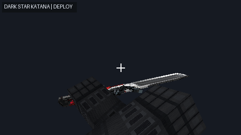
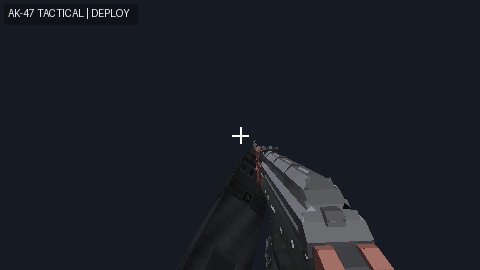
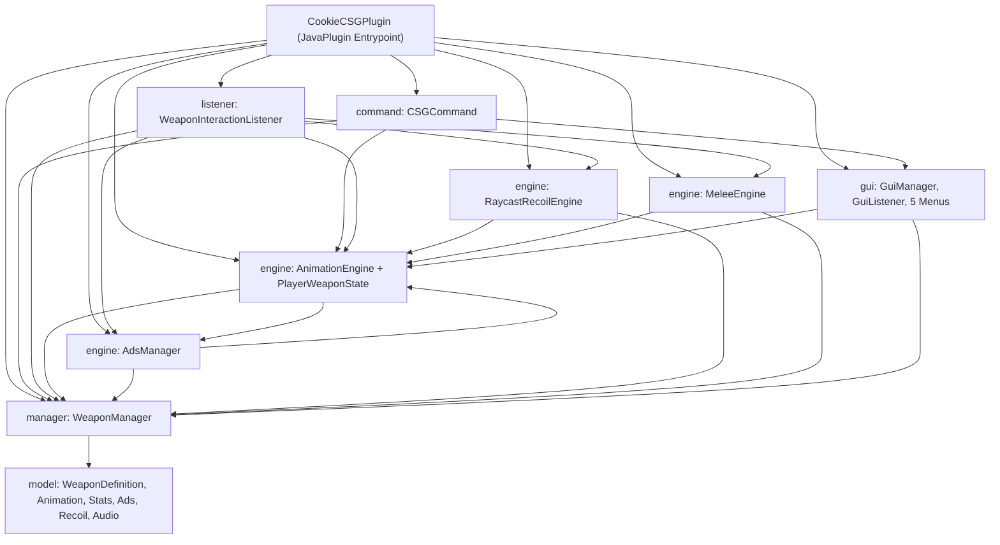
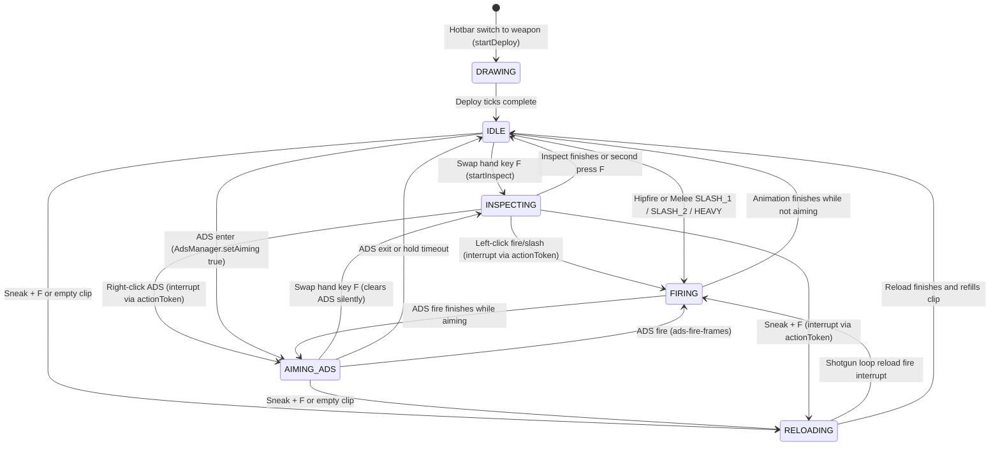

# CookieCSG

[](pom.xml)
[](https://adoptium.net/)
[](https://papermc.io/)
[](pom.xml)
[](src/test/java/com/cookie/csg/)

**CookieCSG** (`CookieCSG-1.2.jar`) is a Paper `1.21.4+` Java tactical weapon plugin supporting both **lightweight vanilla no-model gameplay (`mode: default`)** and a **premium 20 TPS 3D frame-animation engine (`mode: model`)**, complete with raycast recoil ballistics, optical ADS zoom with movement-speed compensation, multi-stage melee combos, bundled Vanilla LOD starter weapons (`p1911` & `bayonet`), and an in-game chest GUI editor.

---

## Key Features

- **Dual Weapon Modes (`mode: default` vs `mode: model`):**
  - **`mode: default` (Vanilla / Simple Mode):** Pure combat weapon without `inspect`, without 3D frame animations, and without an `animation:` section in YAML. Right-click aiming uses pure FOV optical zoom (`AdsManager`), while shooting, recoil, reload timers, melee combos, and sounds work out of the box with zero custom resource pack required.
  - **`mode: model` (Premium 3D Animated Mode):** Full 20 TPS tick-synchronized `deploy`, `fire`, `ads-in` / `ads-fire` / `ads-out`, `inspect`, `reload`, `reload-tactical`, and phased shotgun `intro` / `loop` / `end` shell animations via Paper `1.21.4` `ItemModel` + `CustomModelData` dispatch (`animation:` YAML section).
- **Bundled Vanilla LOD Starter Pack (`Default/`):** CookieCSG `1.2` ships with two ready-to-use, arm-free Vanilla LOD starter weapons — **Colt M1911 (`p1911`)** (`PISTOL`, `22` LOD cubes, `220` frames, `128x128` texture, 2D hotbar icon) and **Bayonet (`bayonet`)** (`KNIFE`, `20` LOD cubes, `211` frames, `64x64` texture, 2D hotbar icon). Both configs load automatically into `plugins/CookieCSG/weapons/` on first boot, and their ItemsAdder pack assets auto-extract into `plugins/CookieCSG/default-pack/` (and `plugins/ItemsAdder/contents/cookie_csg/` if ItemsAdder is installed). Both are also included cleanly in this repository under [Default/CookieCSG](Default/CookieCSG) and [Default/ItemsAdder](Default/ItemsAdder).
- **Raycast Recoil & Ballistics (`RaycastRecoilEngine`):** Multi-pellet shotgun patterns, height-based headshot detection, sprint/airborne/fire-mode spread multipliers, dynamic consecutive-shot spray scaling, and relative camera recoil packets (`ClientboundPlayerPositionPacket` with `Player.setRotation` fallback).
- **Universal ADS & Optical Zoom (`AdsManager`):** Supports both hold-to-ADS watchdog timing and toggle ADS, compensates client FOV reduction across zoom levels `1–5+` via `walkSpeed` + `Attribute.MOVEMENT_SPEED` modifiers, and supports optional scope overlays.
- **Melee Combo & Heavy Mechanics (`MeleeEngine`):** Alternates `SLASH_1` and `SLASH_2` attacks inside an `1800ms` combo window, computes directional horizontal dot-product backstabs for knives, and executes shield-disabling (`100` ticks) heavy axe cleaves with knockback and slowness.
- **In-Game GUI Weapon Editor (`GuiManager`):** Paginated 54-slot weapon browser (`MainMenu`), drag-and-drop quick-import hopper (`WeaponEditorMenu`), live `DEFAULT` / `MODEL` mode toggle (`Slot 20`), `cookie_csg` / `none` ItemModel dispatch toggle (`Slot 31`), frame list editor (`AnimationFramesMenu`), combat stats tuner (`StatsEditorMenu`), and ADS configurator (`AdsEditorMenu`) with instant YAML saving.
- **YAML Weapon Registry (`WeaponManager`):** Hot-reloadable `weapons/*.yml` registry with legacy alias lookup (`m1911`/`colt1911` -> `p1911`, `m249` -> `csgo_m249`, etc.), `PersistentDataContainer` + `(Material, CustomModelData)` + `ItemModel` matching, and automatic `ATTACK_SPEED` / `BLOCK_BREAK_SPEED` cooldown suppression.

---

## Weapon Animation Showcase

| Weapon | Category | Highlighted Animation Clips | Preview |
| :--- | :---: | :--- | :---: |
| **Tactical Axe** | `AXE` | Slash 1, Slash 2, Heavy Cleave, Inspect |  |
| **Dark Star** | `KNIFE` | Slash 1, Slash 2, Heavy Backstab, Inspect |  |
| **Balisong** | `KNIFE` | Slash 1, Slash 2, Heavy Attack, Inspect |  |
| **AK-47** | `RIFLE` | Fire, ADS (Zoom & ADS Fire), Reload, Inspect |  |

---

## Architecture & CodeGraph

CookieCSG separates input handling (`listener`), command dispatch (`command`), YAML registry & item visuals (`manager`), simulation engines (`engine`), inventory editors (`gui`), and configuration data models (`model`).

> See the complete metrics, class index, and runtime sequence pipeline in [Full CodeGraph Documentation](CodeGraph.md).

### Package Dependency Architecture



### Weapon Lifecycle State Machine (`WeaponState`)



---

## Controls, Commands & Permissions

### Default In-Game Controls

- **Left-Click:** Fire gun (`right-click-fire: false`) or Melee Slash (`SLASH_1` / `SLASH_2` combo).
- **Right-Click:** Aim Down Sights — pure FOV zoom in `mode: default`, or animated ADS in `mode: model` (hold or toggle per `config.yml`) — or Melee Heavy Attack (knife backstab / axe shield-breaking cleave).
- **Swap Hand (`F`):** Inspect held weapon in `mode: model` (press `F` again to cancel immediately; disabled in `mode: default`).
- **Sneak + Swap Hand (`Shift + F`):** Reload firearm (supports tactical vs. empty reloads and interruptible shotgun shell loops in both modes).
- **Double-Sneak (`Shift x2` within `400ms`):** Cycle fire mode (`AUTO` / `SEMI_AUTO` / `SINGLE`) on multi-mode firearms.

### Commands & Permissions

Defined in [plugin.yml](src/main/resources/plugin.yml) and handled by [CSGCommand.java](src/main/java/com/cookie/csg/command/CSGCommand.java):

| Command | Aliases / Usage | Description | Permission |
| :--- | :--- | :--- | :--- |
| `/csg` | `/cookiecsg`, `/gun`, `/guns` | Opens the in-game GUI weapons manager (`MainMenu`) for players, or prints help in console | `cookiecsg.use` (`default: true`) |
| `/csg editor` | `/csg gui` | Opens the in-game GUI weapons manager (`MainMenu`) | `cookiecsg.use` |
| `/csg create <id> [type] [default\|model]` | — | Creates a new weapon (`default` if omitted) and opens `WeaponEditorMenu` | `cookiecsg.use` |
| `/csg edit <id>` | — | Opens `WeaponEditorMenu` directly for `<id>` | `cookiecsg.use` |
| `/csg give <player> <id>` | — | Gives `<id>` (including aliases) to `<player>` and syncs held weapon state | `cookiecsg.use` |
| `/csg list` | — | Lists all registered weapons, types, and display names | `cookiecsg.use` |
| `/csg reload` | — | Hot-reloads `config.yml` and all weapon YAML files | `cookiecsg.use` |

Additional declared permission node in `plugin.yml`: `cookiecsg.admin` (`default: op`, reserved for administrative setups).

---

## Configuration

### Global Plugin Config (`src/main/resources/config.yml`)

```yaml
gun-controls:
  right-click-fire: false
  hold-to-ads: true
  hold-ads-release-ms: 350
```

- `gun-controls.right-click-fire`: When `false`, Left-Click fires and Right-Click controls ADS; when `true`, swaps to Right-Click fire and Left-Click ADS.
- `gun-controls.hold-to-ads`: Enables hold-to-ADS behavior when `right-click-fire` is `false`.
- `gun-controls.hold-ads-release-ms`: Release watchdog timeout in milliseconds (minimum clamped to `100ms` in `CookieCSGPlugin`).

### Weapon YAML Schema (`plugins/CookieCSG/weapons/<id>.yml`)

Every weapon declares `mode: default` (simple vanilla weapon, **no `animation:` section**) or `mode: model` (animated 3D weapon, **with `animation:` section**).

#### 1. Vanilla / Simple Weapon (`mode: default`)

```yaml
id: simple_pistol
display-name: '&e&lSimple Service Pistol'
mode: default
type: PISTOL
material: IRON_HOE
stats:
  damage: 7.5
  headshot-multiplier: 2.5
  fire-rate-ticks: 4
  clip-size: 12
  max-ammo: 48
  reload-ticks: 35
  range: 48.0
  fire-modes: [SEMI_AUTO]
  default-fire-mode: SEMI_AUTO
ads:
  enabled: true
  zoom-level: 1
  spread-multiplier: 0.25
  recoil-multiplier: 0.65
  scope-overlay: false
recoil:
  vertical: 1.1
  horizontal: 0.35
  spread: 0.025
  sprint-spread-multiplier: 2.0
audio:
  shoot: minecraft:entity.firework_rocket.blast
  empty: minecraft:block.dispenser.fail
```

#### 2. Premium 3D Animated Weapon (`mode: model`)

```yaml
id: p1911
display-name: '&6&lColt M1911 &7| Vanilla LOD'
mode: model
type: PISTOL
material: IRON_HOE
animation:
  idle-model: 240100
  deploy-model: 380001
  deploy-ticks: 15
  deploy-tick-rate: 1
  deploy-frames: [380001, 380002]
  ads-model: 380030
  ads-fire-model: 380031
  ads-in-frames: [380026, 380027, 380028, 380029]
  ads-fire-frames: [380031, 380032, 380033, 380034]
  ads-out-frames: [380035, 380036, 380037]
  fire-frames: [380016, 380017]
  inspect-frames: [380129, 380130]
  reload-frames: [380038, 380039]
  reload-tactical-frames: [380088, 380089]
stats:
  damage: 8.0
  headshot-multiplier: 3.5
  fire-rate-ticks: 4
  clip-size: 7
  max-ammo: 35
  reload-ticks: 50
  reload-tactical-ticks: 41
  range: 48.0
  movement-speed-multiplier: 0.97
  ads-movement-speed-multiplier: 0.84
  fire-modes: [SEMI_AUTO]
  default-fire-mode: SEMI_AUTO
ads:
  enabled: true
  zoom-level: 1
  spread-multiplier: 0.18
  recoil-multiplier: 0.55
  scope-overlay: false
recoil:
  vertical: 1.35
  horizontal: 0.35
  spread: 0.022
  sprint-spread-multiplier: 2.0
audio:
  shoot: csgo.weapon.p1911.shoot
  ads-in: csgo.weapon.aim.in
  ads-out: csgo.weapon.aim.out
  deploy: csgo.weapon.p1911.deploy
  reload-clip-out: csgo.weapon.p1911.clipout
  reload-clip-in: csgo.weapon.p1911.clipin
  reload-bolt: csgo.weapon.p1911.boltpull
  inspect: csgo.weapon.p1911.inspect
  empty: csgo.weapon.dryfire
  reload-clip-in-tick: 22
  reload-bolt-tick: 39
```

---

## Bundled Default Vanilla LOD Pack (`Default/`)

`CookieCSG-1.2.jar` ships with a ready-to-play Vanilla LOD pack (no arm/hand 3D models, low-poly LOD cube reduction, and 2D hotbar icons):

| Weapon | ID | Mode | Type | Material | LOD Cubes | Frames | Folder |
| :--- | :--- | :---: | :---: | :---: | :---: | :---: | :--- |
| **Colt M1911** | `p1911` (`m1911`, `colt1911`) | `model` | `PISTOL` | `IRON_HOE` | `22` | `220` | [Default/CookieCSG](Default/CookieCSG) / [Default/ItemsAdder](Default/ItemsAdder) |
| **Bayonet** | `bayonet` | `model` | `KNIFE` | `IRON_SWORD` | `20` | `211` | [Default/CookieCSG](Default/CookieCSG) / [Default/ItemsAdder](Default/ItemsAdder) |

- First plugin startup extracts `p1911.yml` and `bayonet.yml` into `plugins/CookieCSG/weapons/` (when empty) and extracts the bundled ItemsAdder tree into `plugins/CookieCSG/default-pack/ItemsAdder/` (and directly into `plugins/ItemsAdder/contents/cookie_csg/` if ItemsAdder is present).

---

## Building & Testing

### Build Plugin JAR

Requires **Java 21** and **Maven 3.9+**:

```bash
mvn package
```

This runs the standalone-compatible test suite and produces `target/CookieCSG-1.2.jar` ready for deployment on Paper `1.21.4+` servers.

### Running Tests

```bash
mvn test
```

The **5 JUnit 5 suites (77 tests)** validate core models, YAML `mode: default` / `mode: model` serialization, bundled default extraction, Default LOD pack validation, GUI/command flows, and simulation engines (external `CookieCSG_DONE/Pack 1..3` checks are automatically skipped via JUnit assumptions when those large external asset packs are absent).
